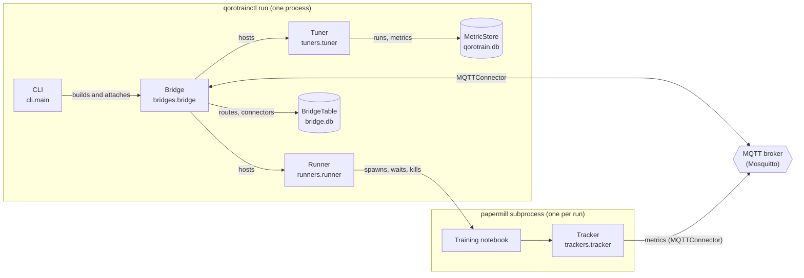
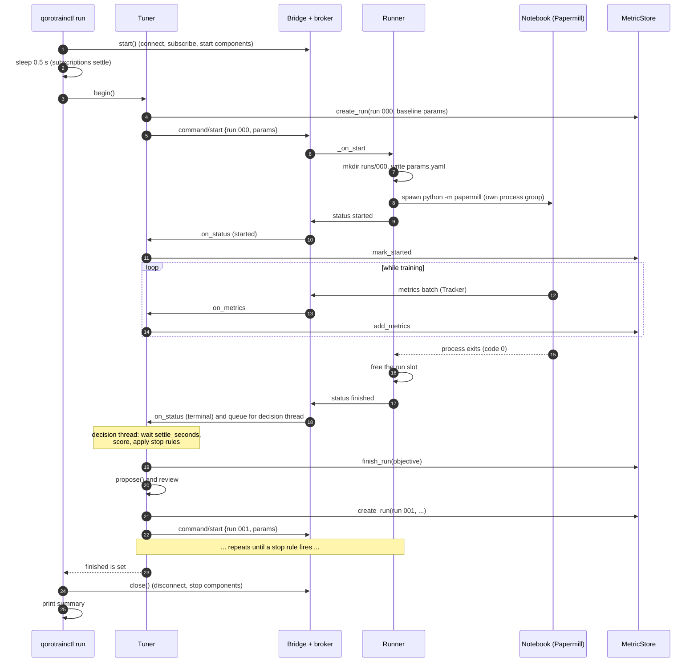
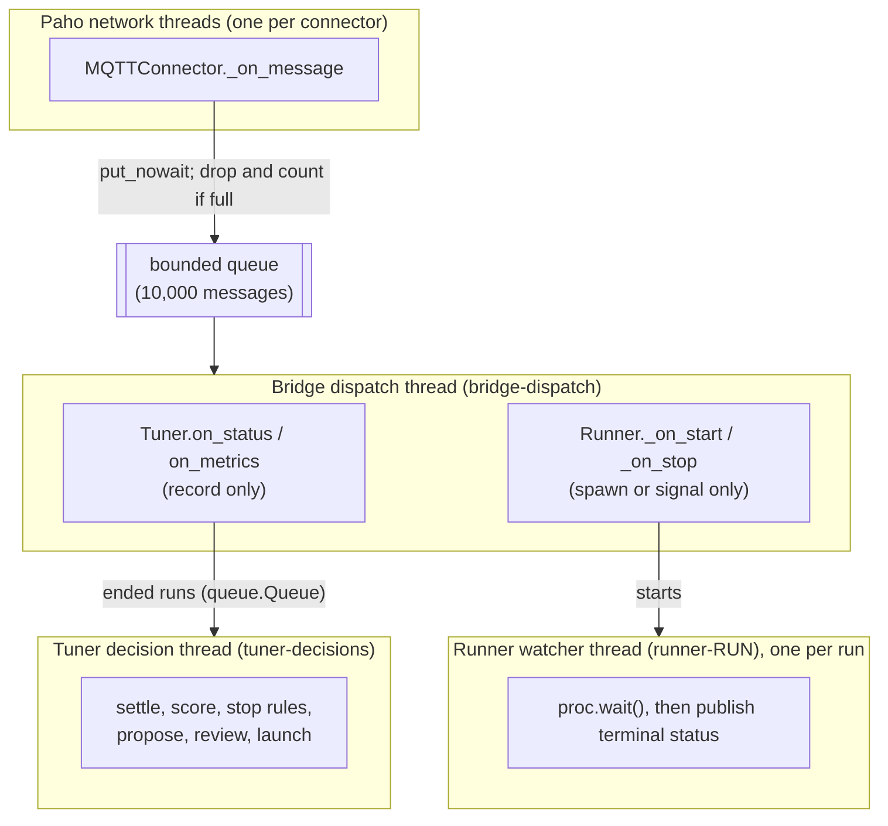
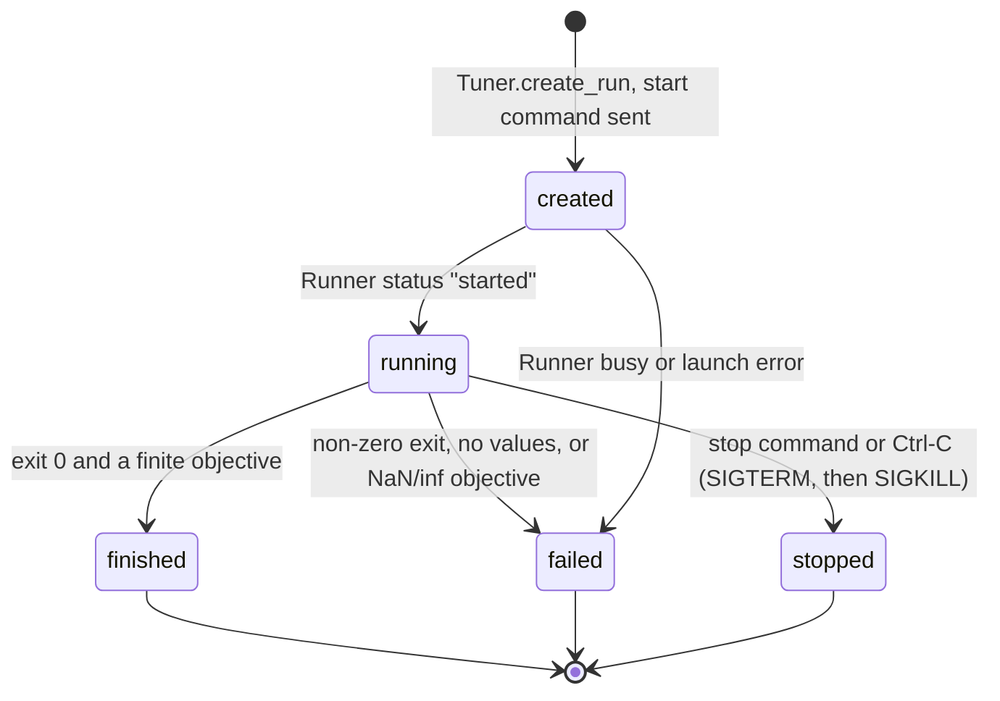
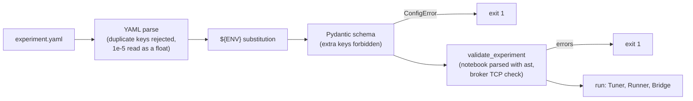

# Architecture

Qorotrain is a small event-driven system. Each component owns one
responsibility, and components exchange versioned JSON messages over an MQTT
broker instead of calling each other.

## Components

| Component | Responsibility | Publishes | Subscribes |
|---|---|---|---|
| **Tracker** (`trackers.tracker`) | Runs inside the notebook. Buffers metric points and publishes them in batches. Never raises into training code. | `<root>/<project>/<run>/metrics` | (nothing) |
| **Connector** (`connectors.connector`) | One client connection to one broker. Turns broker messages into `Message` objects and back. Replays subscriptions on reconnect. | (on behalf of others) | (on behalf of others) |
| **Bridge** (`bridges.bridge`) | Hosts components, keeps broker subscriptions in sync with their routes, and dispatches incoming messages on one thread. Mirrors its state into `bridge.db`. | (on behalf of components) | union of all routes |
| **Runner** (`runners.runner`) | Executes the notebook with Papermill, one run at a time, and reports the run's lifecycle. It is the only source of run status. | `<root>/<project>/<run>/status` | `.../command/start`, `.../command/stop` |
| **Tuner** (`tuners.tuner`) | Records statuses and metrics, scores finished runs, applies stop rules, asks its algorithm for the next configuration, has it reviewed, and starts it. | `.../command/start`, `.../command/stop` | `.../+/status`, `.../+/metrics` |
| **MetricStore** (`store.metric_store`) | SQLite persistence of runs and metric points. Ignores redelivered points. | (none) | (none) |
| **CLI** (`cli.main`) | Composition root: loads and validates the configuration, wires the components together, prints the plan and the summary. | (none) | (none) |

### Why a broker between components in one process?

Today the Tuner and the Runner live in the same process and share one Bridge.
They still talk only through broker topics. This has three effects:

- The notebook process (Tracker) has to use the broker anyway, so every
  component follows one communication model.
- The Runner could move to another machine, for example a GPU host, without
  code changes, because its only interface is the topics.
- Each fact has exactly one publisher. Status comes from the Runner, which is
  the parent of the notebook process and sees its exit code even when the
  notebook crashes or never calls `tracker.finish()`. Metrics come from the
  Tracker.

## Topics and messages

All topics start with `bridge.topic_root` (default `tuning`) and the project
name (`application.name`). They are built only by the helpers in
{mod}`qorotrain.config.contracts.schema`.

| Topic | Publisher | Payload type | QoS |
|---|---|---|---|
| `<root>/<project>/command/start` | Tuner | {class}`~qorotrain.config.contracts.schema.StartCommand` `{"v":1,"run":…,"params":{…}}` | 1 |
| `<root>/<project>/command/stop` | Tuner | {class}`~qorotrain.config.contracts.schema.StopCommand` `{"v":1,"run":…}` | 1 |
| `<root>/<project>/<run>/status` | Runner | {class}`~qorotrain.config.contracts.schema.Status` `{"v":1,"run":…,"state":…,"ts":…,"exit_code"?,"error"?}` | 1 |
| `<root>/<project>/<run>/metrics` | Tracker | {class}`~qorotrain.config.contracts.schema.MetricBatch` `{"v":1,"run":…,"points":[{"step":…,"t":…,"values":{…}}]}` | 1 |

Every payload carries the schema version `"v": 1`. Decoding is strict. A
malformed payload raises `SchemaError`, and handlers log it and ignore the
message, so bad input is rejected in one place.

**At-least-once delivery.** QoS 1 can deliver a message twice, and each
receiver handles duplicates:

| Duplicate | Handled by |
|---|---|
| Start command | The Runner remembers run ids it has seen and ignores repeats. |
| Terminal status | The Tuner clears its "current run" when the first one arrives, so later copies are ignored. |
| Metric batch | The store's primary key `(run_id, name, step)` with `INSERT OR IGNORE`. |
| `started` status | `mark_started` only changes a run that is still `created`. |

## One tuning session

Runs are strictly sequential. The Tuner starts the next run only after the
previous run's terminal status has been handled. The Runner frees its slot
*before* it publishes the terminal status, so the next start command never
finds it busy.

## Concurrency model

| Thread | Runs | Rule |
|---|---|---|
| Paho network thread | Connector callbacks | Only enqueue and return. Never block it. |
| `bridge-dispatch` | Every route handler, one at a time, in arrival order | Handlers only record or hand off work, so one slow handler does not delay all traffic. |
| `tuner-decisions` | Scoring, `propose`, review | May be slow: an LLM call or waiting for a person. Metrics keep flowing meanwhile. |
| `runner-<run>` | Waits for the Papermill process | Publishes the terminal status. |
| `threading.Timer` | SIGKILL escalation | Fires `grace_seconds` (5 s) after SIGTERM if the process is still alive. |
| Main thread | CLI | Polls `tuner.wait(0.2)` so that Ctrl-C is handled promptly. |

Shared state is protected with locks: the Bridge's route list (`RLock`), the
Tuner's session state (`RLock`), the Runner's active run, the Tracker's buffer,
and the SQLite connections (one connection per database, shared across threads
and serialised by a lock, in WAL mode).

**Back-pressure.** If handlers fall behind, the dispatch queue fills up. New
messages are then dropped and counted in `Bridge.dropped`; the broker's
network thread is never blocked. The Tracker batches points (50 points or 1 s)
to keep the message rate low.

## Run lifecycle

`runs.status` in the store follows this diagram. A run whose notebook exits
cleanly but logs no value of the objective metric, or whose objective is NaN
or infinite, is recorded as **failed**, with the reason in `runs.error`.

## Failure handling

| Situation | Behaviour |
|---|---|
| Broker unreachable at start | `validate` reports it. `run` exits with code 1 (`cannot connect to the broker`). |
| Start command lost (Runner not yet subscribed) | Start watchdog: re-send once after `start_timeout` (30 s), then end the session. |
| Notebook raises or crashes | Runner publishes `failed` with the exit code and the last 12 lines of `papermill.log`. |
| Notebook killed by a signal | `failed` with `terminated by signal N`. |
| Run diverges (NaN/inf objective) | Trial recorded as `failed`, with an explanation. |
| Three consecutive failures | Session ends: `3 consecutive failed runs`. |
| Proposal or reviewer edit out of range | Session ends: `invalid proposal: ...` or `invalid edit: ...`. |
| Handler raises | The Bridge logs the exception and continues with the next handler. |
| Telemetry error in the notebook | One `RuntimeWarning` per kind of error; the data is dropped; training continues. |
| Ctrl-C | Tuner aborts and sends a stop command; Runner sends SIGTERM to the run's process group and SIGKILL after 5 s; summary printed; exit code 130. |
| Unexpected exception on the decision thread | Session ends with `internal error (see the log)`. |

## Configuration pipeline

The schema in {mod}`qorotrain.config.models` is the single source of truth.
The [configuration reference](configuration.md) is generated from it by
{mod}`qorotrain.config.reference`, and a test fails if the two drift apart.
Notebooks are inspected statically with `ast`; validation never executes a
cell.

## Design patterns in the code

| Pattern | Where | Purpose |
|---|---|---|
| Mediator | `Bridge` | Components never reference each other or the broker client. |
| Protocol (structural typing) | `Component`, `Reviewer` | Anything with the right methods can be hosted or review proposals. |
| Template method | `Tuner.propose` | Every algorithm shares the same loop, so comparisons isolate the search strategy. |
| Factory | `create_connector`, `create_tuner` | Maps configuration to concrete classes in one place. |
| Adapter | `MQTTConnector` | Hides Paho behind the `Connector` interface and the broker-neutral `Message`. |
| Producer and consumer queues | Bridge dispatch queue, Tuner `_ended` queue | Decouple fast producers (network) from slow consumers (handlers, decisions). |
