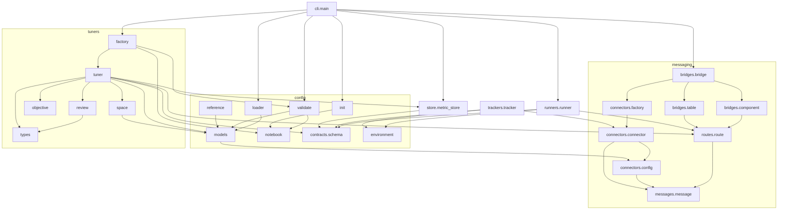

# Modules

The source lives in `src/qorotrain/` (src layout, built with `uv_build`).
Several subpackages (`bridges`, `cli`, `connectors`, `messages`, `routes`,
`runners`, `trackers`, `config/contracts`) have no `__init__.py` and are
implicit namespace packages. They import normally, and they are listed module
by module in the [API reference](reference/index.md).

## Package map

| Module | Responsibility | Key names |
|---|---|---|
| `qorotrain` | Package root. Re-exports only what a notebook needs. | `Tracker`, `main` (placeholder script) |
| `qorotrain.main` | `python -m qorotrain.main` runs the CLI. **Exits at import**, so it is not in the API reference. | (none) |
| **Configuration** | | |
| `config` | Facade over the configuration modules. | `load_experiment`, `validate_experiment`, `generate_experiment`, `ConfigError` |
| `config.models` | Pydantic schema of `experiment.yaml`; unknown keys are rejected. | `ExperimentSpec`, `HyperParamSpec`, `TunerSpec`, ... |
| `config.loader` | YAML parsing (strict), `${ENV}` substitution, schema validation, error formatting. | `load_experiment`, `parse_experiment`, `ConfigError` |
| `config.validate` | Checks against the notebook and the broker: errors versus warnings. | `validate_experiment`, `ValidationReport`, `resolve_source` |
| `config.notebook` | Static notebook inspection with `ast` (never executes). | `read_notebook`, `parse_parameters`, `NotebookInfo` |
| `config.init` | Generates a starting `experiment.yaml` with guessed ranges. | `generate_experiment`, `classify` |
| `config.reference` | Generates the configuration reference from the schema. | `fields`, `render_markdown`, `DESCRIPTIONS` |
| `config.environment` | Names of the `QOROTRAIN_*` variables shared by Runner and Tracker. | `ENV_RUN_ID`, `ENV_BROKER`, ... |
| `config.contracts.schema` | JSON wire contract and topic helpers. | `StartCommand`, `Status`, `MetricBatch`, `encode`, `decode_*` |
| **Messaging** | | |
| `messages.message` | Broker-neutral message envelope. | `Message` |
| `routes.route` | MQTT topic filters and routes. | `Route`, `topic_matches` |
| `connectors.config` | Runtime broker configurations. | `MQTTConfig`, `BrokerConfig` |
| `connectors.connector` | Connector interface and Paho-based MQTT implementation. | `Connector`, `MQTTConnector` |
| `connectors.factory` | Configuration to connector. | `create_connector` |
| `bridges.component` | Interface of hosted components. | `Component` |
| `bridges.bridge` | Hub: connectors, routing, dispatch thread, components. | `Bridge` |
| `bridges.table` | SQLite mirror of connectors and routes. | `BridgeTable` |
| **Execution** | | |
| `runners.runner` | Runs the notebook with Papermill and reports status. | `Runner` |
| `trackers.tracker` | In-notebook telemetry client. | `Tracker` |
| **Tuning** | | |
| `tuners` | Facade over the tuning modules. | `RandomTuner`, `GridTuner`, `Decision`, ... |
| `tuners.tuner` | The tuning loop (abstract) and the algorithms. | `Tuner`, `RandomTuner`, `GridTuner`, `StopTuning` |
| `tuners.space` | Validation, sampling and grids over the search space. | `SearchSpace`, `MAX_GRID_SIZE` |
| `tuners.objective` | Metric stream to score; comparisons. | `aggregate`, `is_better` |
| `tuners.review` | Human-in-the-loop hook. | `Reviewer`, `Decision`, `AutoApprove` |
| `tuners.types` | Data exchanged with algorithms. | `Trial`, `Proposal` |
| `tuners.factory` | Configuration to tuner; baseline from the notebook. | `create_tuner`, `initial_from_notebook` |
| **Persistence and interface** | | |
| `store.metric_store` | SQLite runs and metrics. | `MetricStore` |
| `cli.main` | `qorotrainctl`: `init`, `validate`, `run`. | `main`, `cmd_run`, ... |

Outside the package, `examples/` holds a complete, runnable example:
`bandits.ipynb` (an epsilon-greedy n-armed bandit instrumented with the
Tracker) and `bandits.yaml` (its experiment).

## Dependencies between modules

Arrows point from a module to the modules it imports. Facade packages and
`TYPE_CHECKING`-only imports are omitted.

Things to notice:

- **The messaging layer depends on nothing else in Qorotrain.** `messages`,
  `routes`, `connectors` and `bridges` can be used and tested without any
  configuration, Tuner or Runner.
- **`config.contracts.schema` is the only shared contract** between processes,
  together with `config.environment`. The Tracker runs inside the notebook and
  imports only the connector, the schema and the environment names. It never
  imports the Bridge, the Tuner or the YAML schema.
- **The Tuner and the Runner do not import each other.** They meet only
  through topics on the Bridge.
- `config.models` imports `connectors.config`, so that `ConnectorSpec.to_config()`
  can build an `MQTTConfig`. This is the one place where the configuration
  layer depends on the messaging layer.

## Third-party dependencies

| Package | Used by | For |
|---|---|---|
| `paho-mqtt` 2.x | `connectors.connector` | MQTT v5 client (`CallbackAPIVersion.VERSION2`). |
| `pydantic` 2.x | `config.models`, `config.loader`, `config.reference` | Schema validation and introspection. |
| `pyyaml` | `config.loader`, `config.init`, `runners.runner` | YAML parsing and writing `params.yaml`. |
| `nbformat` | `config.notebook` | Reading `.ipynb` files. |
| `papermill` | `runners.runner` (as a subprocess) | Parameter injection and notebook execution. |
| `sqlite3` (standard library) | `store.metric_store`, `bridges.table` | Persistence. |

`langchain`, `langchain-chroma`, `langchain-google-genai`, `langchain-openai`,
`langgraph` and `pgvector` are declared in `pyproject.toml` for the planned LLM
agent. No current module imports them.

## Tests

Tests live in `tests/` and use pytest with plain functions. `tests/helpers.py`
provides `FakeConnector`, an in-memory connector, and `wait_for`.
`tests/nbhelpers.py` builds throw-away notebooks and YAML files. Tests marked
`broker` (`test_mqtt_integration.py`, `test_e2e.py`) skip themselves unless a
broker is listening on `localhost:1883`; the end-to-end tests also need
Papermill and a `python3` kernel.
